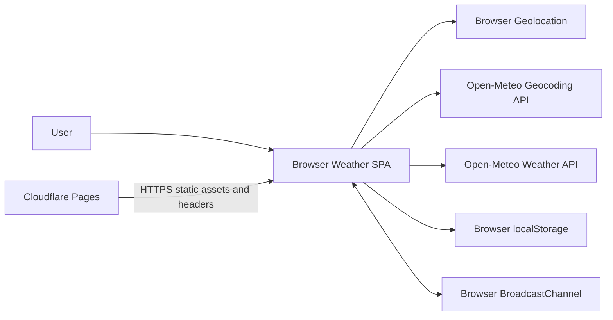
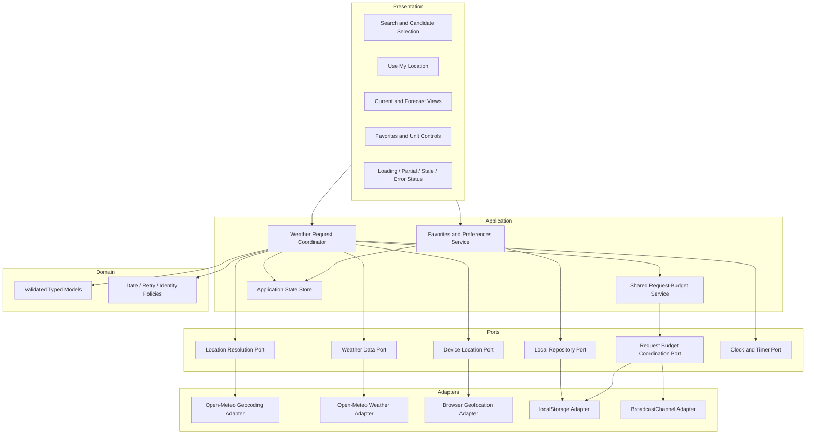

# Weather Application Architecture

## 1. Document Control and Approval Gate

| Item | Value |
|---|---|
| SDLC stage | Architecture revision following approved implementation-plan blocker dispositions |
| Authoritative artifact | Repository-root `architecture.md` |
| Requirements baseline | Revised repository-root `requirements.md` |
| Revision sources | Approved `requirements.md` and user-approved dispositions B-001 through B-016, supplied 2026-10-27 |
| Supersedes | Architecture approved on 2026-10-27 |
| Revised architecture status | **Approved by the user on 2026-10-27** |
| Production implementation authorized | No |
| Implementation planning authorized | Revision only; implementation is not authorized |
| Next permitted action | Independent Stage 3 design re-review |

This artifact aligns the architecture with the approved requirements and all
approved blocker dispositions B-001 through B-016. The supplied product and
tooling decisions are recorded as **Approved input**.
Technical architecture choices introduced to make those inputs implementable
are recorded as **Approved architecture decision**.
Non-binding guidance is recorded as **Recommendation**. Unavailable information
is recorded exactly as **Not Found**.

The decisions in this revision are approved as of 2026-10-27. Because the
architecture baseline has materially changed after the existing
`design-review.md`, **Stage 3 re-review is required before any implementation
begins**. The existing review and implementation plan are historical inputs,
not authorization to implement this revised baseline.

## 2. Evidence Inspected

| Evidence | Architectural use |
|---|---|
| `requirements.md` | Approved source for FR-001 through FR-007, NFR-001 through NFR-016, AC-001 through AC-044, business rules, and unresolved information |
| `design-review.md` | Required findings DR-001 through DR-009 and recommendations DR-010 through DR-013 |
| `impl-plan.md` | Blocker definitions B-001 through B-016 and logical implementation boundaries |
| Existing `architecture.md` | Previously approved logical architecture |
| Existing source, dependency manifests, tests, build, hosting, and deployment configuration | **Not Found** |
| Referenced architecture skill file | **Not Found** |

## 3. Scope and Architecture Drivers

### 3.1 Product boundary

**Approved input:** The product is a browser single-page application (SPA).
The SPA calls Open-Meteo weather and geocoding APIs directly. Open-Meteo does
not require a confidential key for this integration. A backend-for-frontend
(BFF) is not selected.

The SPA supports city search and candidate selection, explicitly initiated
device location, current conditions, the next three forecast days, unit
selection, refresh/retry, local favorites/preferences, and responsive
presentation.

Accounts, cross-device synchronization, notifications, maps, historical
weather, and administrative functions are **Not Found**.

### 3.2 Quality drivers

1. Never mix results for different locations or temperature units (BR-013).
2. Bound geolocation and Open-Meteo requests and prevent retry storms
   (FR-002, FR-005, NFR-005).
3. Validate all browser, provider, and persisted input before use (NFR-004).
4. Publish useful partial weather without waiting indefinitely or fabricating
   missing data (FR-003, FR-004, DR-009).
5. Preserve prior weather as explicitly stale after refresh failure
   (BR-011).
6. Persist only the permitted minimum location and unit data (FR-006,
   NFR-007).
7. Meet WCAG 2.2 AA, keyboard/screen-reader, browser, responsive, locale,
   Core Web Vitals, initial bundle, and static-load targets (NFR-003,
   NFR-008, NFR-010 through NFR-012).
8. Send no telemetry and retain only the approved local data (NFR-014,
   NFR-015).
9. Avoid speculative infrastructure without an approved driver (DR-013).

## 4. System Context and Deployment

- The user supplies city text, chooses candidates, explicitly invokes device
  location, selects units, refreshes/retries, and manages favorites.
- Browser geolocation is invoked only after **Use my location** is selected.
- Open-Meteo responses are untrusted external input.
- `localStorage` is an untrusted persistence boundary scoped to the browser
  profile and origin.
- `localStorage` is also the durable authority for the shared request budget;
  `BroadcastChannel`, when available, accelerates same-origin tab convergence
  but is not the durable source.

**AD-001 — Approved architecture decision: browser
ports-and-adapters.** Presentation depends on application use cases and
validated domain models. Browser geolocation, Open-Meteo, and `localStorage`
are accessed through ports and adapters. Provider payloads and persisted JSON
do not enter presentation state directly.

**AD-002 — Approved input: direct Open-Meteo deployment.** Calls originate in
the browser; no BFF or confidential provider secret is introduced. The
approved deployment is non-commercial and must display the attribution
required by Open-Meteo.

### 4.1 Verified Open-Meteo contracts

The following contracts were verified on 2026-10-27 against the official
[geocoding documentation](https://open-meteo.com/en/docs/geocoding-api),
[forecast documentation](https://open-meteo.com/en/docs), and
[terms](https://open-meteo.com/en/terms), plus live browser-origin requests:

- City search: `GET https://geocoding-api.open-meteo.com/v1/search` with
  `name`, `count`, `language`, and `format=json`. Used candidate fields are
  `id`, `name`, `latitude`, `longitude`, `timezone`, `country`, and `admin1`.
- Weather: `GET https://api.open-meteo.com/v1/forecast` with `latitude`,
  `longitude`, current variables `temperature_2m`,
  `relative_humidity_2m`, and `weather_code`; daily variables `weather_code`,
  `temperature_2m_max`, and `temperature_2m_min`; `temperature_unit`;
  `timezone=auto`; and enough days for today plus the next three local dates.
- Both tested endpoints returned `Access-Control-Allow-Origin: *`, confirming
  the selected browser call topology.
- The free endpoint is limited to non-commercial use and 10,000 calls/day,
  5,000/hour, and 600/minute, has no uptime guarantee, and requires data
  attribution under CC BY 4.0.
- The documented geocoding contract is name-based. No reverse-geocoding
  contract is assumed for device coordinates.

Provider responses remain untrusted. Contract fixtures shall include success,
empty, ambiguous, malformed, partial, HTTP error, rate-limit, and oversized
payload cases. A commercial deployment or provider contract change requires a
new architecture decision because a paid credential must not be exposed by
this direct-client topology.

### 4.2 Build, hosting, and delivery

**AD-010 — Approved architecture decision: TypeScript/React/Vite/npm
toolchain.** Production source uses TypeScript and React, built as native ES
modules by Vite and managed by npm. Development and CI use the Node.js release
line officially designated Active LTS when the implementation baseline is
created; `package.json` engine metadata and CI setup pin that resolved major
while the lockfile makes dependency resolution reproducible. Module boundaries follow
the Presentation/Application/Domain/Ports/Adapters layers in Section 5;
dependencies point inward, and adapters are wired at the application entry
composition root.

**AD-011 — Approved architecture decision: Cloudflare Pages static
hosting.** Vite emits static assets for Cloudflare Pages. SPA navigation uses
an explicit committed Pages route/fallback configuration. A committed
Cloudflare Pages `_headers` configuration is the authoritative deployed
security-header configuration and is verified against the deployed site.
There is no server runtime, edge function, BFF, service worker, or weather
cache.

## 5. Logical Components

**AD-003 — Approved architecture decision: single request
coordinator.** Search selection, favorite selection, geolocation success, unit
change, refresh, and retry all enter one coordinator. It owns the active
request token and atomically associates state with a location identity and
unit.

**AD-004 — Approved architecture decision: typed trust
boundaries.** Adapters return provider-neutral typed success, partial, or
failure results. Shape/type/range/size validation and provider-to-domain error
mapping are defined before adapter implementation, as adopted from DR-011.
Diagnostics remain separate from safe user-facing message keys.

**AD-005 — Approved architecture decision: local repository
abstraction.** A repository validates and version-controls the one
favorites/preferences document. Storage failures do not crash the SPA or
cause it to claim persistence succeeded.

**AD-006 — Approved architecture decision: no speculative
infrastructure.** No BFF, cache, queue, database, autoscaling layer, or
service-side telemetry system is selected. Such infrastructure requires a
later approved security, quota, scale, or performance driver (DR-013).

## 6. Domain and Port Contracts

### 6.1 Domain models

| Model | Required content | Rules |
|---|---|---|
| `LocationIdentity` | namespace; optional Open-Meteo location ID; latitude and longitude | Search identities use `open-meteo-search`, ID, and provider-returned coordinates; device identities use `device-coordinates` and validated browser coordinates |
| `LocationRef` | identity; city; administrative region; country | Missing display fields are represented as unavailable, never fabricated |
| `UnitPreference` | `celsius` or `fahrenheit` | Defaults to Celsius when no valid persisted value exists |
| `CurrentConditions` | component state | Validated temperature/unit, humidity/unit, condition semantic, and icon semantic may each be unavailable |
| `ForecastDay` | validated local calendar date; component state | Daily high and low/unit, condition semantic, and icon semantic may each be unavailable |
| `WeatherSnapshot` | request token; atomic `LocationIdentity`; atomic unit; current state; forecast state | May include last successful retrieval time, stale marker, and safe component errors |
| `Favorite` | identity namespace, optional Open-Meteo ID, coordinates, city, administrative region, country | No weather, permission, history, or search data |
| `PreferencesDocument` | schema version, unit, unique favorites | Untrusted until the v1 envelope and entries are validated |
| `OperationError` | category, retryability, safe message key | Diagnostics/correlation data must omit secrets and unnecessary precise coordinates |
| `RequestBudgetDocument` | validated window counters, window identifiers, revision/write metadata | Separate versioned key from favorites; contains no location, search, weather, or user content |

Search-favorite identity comparison uses the `open-meteo-search` namespace,
exact validated Open-Meteo ID, and both coordinates at provider-returned
precision. An ID-less search candidate fails validation. Device-favorite
identity uses the `device-coordinates` namespace and validated browser
coordinates. Display text and user spelling never determine equality. When a
later search candidate has the same provider-precision coordinates but a
changed ID, the repository migrates the existing search identity rather than
adding a duplicate.

To preserve coordinate precision through JSON parsing and reserialization, the
adapter/domain boundary retains each validated coordinate's provider-returned
decimal representation rather than rounding it. Conversion to a numeric
request parameter must preserve the same value.

### 6.2 Port result contracts

Each asynchronous port returns a discriminated result rather than throwing
unclassified provider values:

- success: validated value and safe metadata;
- partial: valid values plus explicit unavailable fields;
- failure: one of `not_found`, `permission_denied`, `unavailable`, `timeout`,
  `network`, `rate_limited`, `http_client`, `http_server`, `validation`,
  `storage`, or `cancelled`, with retry metadata where applicable.

Before decoding JSON into provider-neutral models, adapters enforce a 1 MiB
response-body cap. Accepted strings are at most 200 characters; geocoding
results are at most 20; each daily array is at most 16; latitude is
`[-90, 90]`, longitude is `[-180, 180]`, and humidity is `[0, 100]`; all
numbers must be finite. Temperature is limited to `[-100, 70]` Celsius or
`[-148, 158]` Fahrenheit, elevation to `[-500, 9000]` metres, provider IDs to
positive JavaScript-safe integers, and WMO weather codes to `[0, 99]`.
Required-field absence/type
changes, excess arrays, and out-of-range values reject the affected contract
rather than being coerced. Unknown extra fields alone may be ignored.

The WMO mapping is exactly requirements Section 7.1; an otherwise-valid
unrecognized integer maps to **Unknown conditions** and `unknown`. Semantic
keys resolve only to bundled local SVG assets. Contract fixtures cover all
mapped codes, unknown codes, valid boundaries, one-past-boundary cases,
malformed and incompatible payloads.

### 6.3 Ports

| Port | Responsibility |
|---|---|
| Location Resolution | Search city text and return validated candidates or typed failure; no reverse-geocoding responsibility |
| Weather Data | Obtain current and forecast components for one atomic location/unit request identity |
| Device Location | Mediate explicit browser permission and return coordinates or denial/timeout/unavailable |
| Local Repository | Load, validate, isolate invalid v1 entries, and atomically replace the versioned document; no legacy migration initially |
| Request Budget Coordination | Reserve a provider request before dispatch, persist shared counters, observe cross-tab changes, and return allowed or budget-exhausted without location data |
| Clock and Timer | Supply testable location-date, timeout, cooldown, embargo, and retrieval-time behavior |

## 7. Location Resolution and Geolocation

### 7.1 City flow

1. Trim input. Reject empty input locally without an Open-Meteo call.
2. Start a geocoding operation under a new active selection token.
3. Validate all returned candidates.
4. Zero candidates produces `not_found`. One candidate is selected. Multiple
   candidates are displayed for user selection.
5. Candidate rows identify city, administrative region, and country. Missing
   administrative region or country is shown as unavailable and the
   candidate remains selectable. A missing/empty city/name, invalid
   Open-Meteo ID, or invalid coordinates rejects the candidate.
6. No weather call starts for an ambiguous result until the user selects a
   candidate.
7. Candidate selection establishes the canonical `LocationIdentity` and
   begins the common weather flow.

### 7.2 Device-location flow

**Approved input:** Browser geolocation is never requested on startup. It is
requested only after the user selects **Use my location**.

The adapter uses the browser permission flow and a 10-second timeout. Success
coordinates are validated, assigned a `device-coordinates` identity, and sent
directly to the weather flow; no unsupported Open-Meteo reverse-geocoding call
is assumed. Denial, unavailable position, and timeout have distinct safe
messages, and city search remains available. A timed-out or superseded
geolocation callback is ignored.

Coordinates are not persisted unless the user saves the resolved location as
a favorite. Device permission state is never persisted.

## 8. Weather Coordination and Atomic Partial Publication

**AD-007 — Approved architecture decision: request-scoped
aggregation state machine.** This decision resolves DR-009.

### 8.1 Request identity and tokens

- Each selection-changing action creates a monotonically unique request token.
- The immutable request identity is
  `(token, identity namespace, optional provider ID, latitude, longitude,
  unit)`.
- Unit change persists the new unit, invalidates the prior active token, and
  refetches the same selected location. Existing numeric values are not
  relabelled as the new unit.
- A manual refresh for the same active identity is single-flight. Duplicate
  refresh actions do not create another operation.
- Search, favorite selection, geolocation selection, unit change, or a newer
  retry invalidates/cancels older work. Every component completion and every
  state commit checks token ownership.

### 8.2 Component state machine

Current conditions and forecast each move independently:

`idle -> loading -> success | unavailable | error | timeout | cancelled`

`success`, `unavailable`, `error`, `timeout`, and `cancelled` are terminal for
that component attempt. Each network attempt has its own 10-second timeout and
cancellation signal. Timeout or cancellation actively aborts where the
browser API supports it; otherwise late completion is ignored.

Validation can yield component success with unavailable fields. A malformed
whole component yields terminal `error(validation)`. One component's failure
does not convert a valid other component into failure.

### 8.3 Publication rule

1. A request-scoped aggregator waits until both current and forecast
   components are terminal; neither can hold publication beyond its bounded
   attempt/retry policy.
2. It then publishes one snapshot containing one immutable location/unit
   identity and both component terminal states. This permits explicit partial
   success without mixed-location or mixed-unit data.
3. A commit is accepted only if its token is still active. Stale-token
   results, including late timeouts, callbacks, and responses, are rejected.
4. A later component result may supersede a published partial snapshot only
   when it belongs to the same still-active token and results from that
   token's allowed retry path. The aggregator republishes the complete
   snapshot atomically; it never patches a different location or unit.
5. Once a token is inactive, no result under it can publish. A manual retry is
   a new token and must pass the same aggregation rule.
6. On refresh total or partial failure, corresponding prior successful values
   may remain visible only with a stale marker and current component error.
   Initial-load failures do not fabricate prior data.

If Open-Meteo supplies current and forecast in one response, the adapter still
maps them to the two component states before publication.

## 9. Network, Retry, and Rate-Limit Policy

**AD-008 — Approved architecture decision: bounded retry
policy.** This decision resolves DR-006 and applies independently to each
Open-Meteo geocoding or weather network request.

### 9.1 Timeout and cancellation

- The 10-second network timeout is **per attempt**, beginning immediately
  before dispatch and ending when a complete response is available for
  validation.
- A request may have one initial attempt and at most one automatic retry.
- Supersession, navigation away from relevant state, or explicit cancellation
  ends the active operation and prevents retry/publication.

### 9.2 Retry classification

The following are transient and eligible for the one automatic retry:

- network failures;
- per-attempt timeout;
- HTTP 408;
- HTTP 429; and
- HTTP 5xx.

They become terminal for the active operation when a valid `Retry-After`
requires waiting longer than the active operation policy permits. Other HTTP
4xx responses and all input/provider validation failures are non-transient and
receive no automatic retry.

For this client operation policy, an automatic retry wait is bounded to 10
seconds. Consequently, a valid `Retry-After` of more than 10 seconds is not
slept inside the active operation: the operation ends in a terminal
rate-limited/service state, while the retry embargo remains recorded for its
full valid duration. This reuses the approved 10-second bound rather than
creating an unbounded loading state. A response with no usable delay uses the
backoff rule below.

### 9.3 Retry timing

- Parse `Retry-After` as either non-negative delta-seconds or a valid HTTP
  date. Past dates permit immediate eligibility. Invalid values are treated as
  absent, not as permission for repeated retries.
- A valid applicable `Retry-After` takes precedence over local backoff.
  Automatic and manual calls for the affected operation/provider are blocked
  until its embargo expires.
- When `Retry-After` is absent or invalid, the sole automatic retry uses
  bounded jittered backoff selected uniformly from 250 through 1,000
  milliseconds. Because only one retry is allowed, no further exponential
  sequence exists.
- Every manual retry creates a new request token, but a second manual retry
  cannot start until one second after the prior manual retry was initiated.
  An applicable longer `Retry-After` embargo takes precedence.
- The UI exposes timeout, rate-limit wait, terminal service error, and cooldown
  states and disables disallowed retry actions.

This produces a worst-case component operation of two 10-second attempts plus
at most a 10-second `Retry-After` wait (or at most one second of local
backoff), unless cancelled or superseded earlier.

### 9.4 Shared request budget and online-only operation

**AD-012 — Approved architecture decision: browser-profile budget
coordination.** Every Open-Meteo attempt, including an automatic retry, must
obtain a reservation immediately before dispatch. The application permits no
more than 100 dispatched requests in the applicable hour and 500 in the
applicable day across same-origin tabs in one browser profile. A request
blocked before dispatch does not consume a reservation. Provider limits and
provider-wide `Retry-After` embargoes always take precedence when stricter.

The budget adapter stores a compact versioned counter document in a dedicated
`localStorage` key and uses `BroadcastChannel` when available, plus `storage`
events, to notify other tabs. Because Web Storage has no compare-and-swap, reservation executes
inside a same-origin Web Locks API exclusive lock: read/validate, prune or
reset the applicable windows, append the unique attempt reservation, write,
confirm, and only then dispatch. If the lock API or durable budget storage is
unavailable, lock acquisition is cancelled, or persistence/confirmation is
uncertain, provider dispatch fails closed with a budget-coordination warning
rather than risking excess. This lock/confirm behavior and cross-tab races
are mandatory browser-matrix tests. `localStorage` remains the durable
counter source and `BroadcastChannel` remains the active-tab notification
mechanism; the lock carries no business data.

The counters use rolling 60-minute and rolling 24-hour windows. Expired
timestamps are pruned before the locked read-check-increment-confirm sequence;
boundary fixtures cover exact expiry instants and clock changes.

The SPA is online-only. It registers no service worker and stores no weather
response cache. Offline detection is advisory; failed live requests still use
the typed network failure path, prior in-memory weather may remain only under
the stale rules, and the UI states that live weather requires a connection.

## 10. Forecast and Unit Semantics

**Approved input:** Celsius is the default. Celsius and Fahrenheit are the
only valid preferences. The selected unit applies to current weather,
forecast, refresh, favorite selection, and subsequent calls. Unit changes are
persisted and cause a refetch.

Current temperatures and daily high/low temperatures are rounded to the
nearest whole degree for display only. Validated provider values remain
separate from display formatting. Exact half values round away from zero.

**Approved input:** “Next three days” means the three calendar dates
immediately after today in the selected location's Open-Meteo-supplied
timezone. Today is excluded.

Forecast preparation:

1. Require a validated selected-location timezone. If absent or invalid, mark
   forecast unavailable; never fall back to device timezone or UTC.
2. Derive today's local calendar date using that timezone and the clock port.
3. Parse each provider forecast date as a strict calendar date. Reject
   malformed/impossible dates and malformed records.
4. Discard today and past dates.
5. Deduplicate by local calendar date deterministically. Identical records
   collapse to one; if any forecast value differs, reject all records for that
   date. Sort remaining records ascending and select only the three calendar
   dates immediately after today. A duplicate never creates another day.
6. A date outside the three immediately following calendar dates does not
   substitute for a missing required date. Show valid required dates and mark
   remaining days unavailable.
7. Daylight-saving transitions affect clock offsets but not the calendar-date
   sequence.

The successful-update timestamp is the browser clock instant at which the
validated application retrieval succeeds, formatted in the selected
location's validated timezone. It is labelled as application retrieval time,
not provider observation time.

## 11. Favorites and Preferences Persistence

**Approved input:** One versioned `localStorage` document contains the unit
preference and favorites. A favorite contains only:

- identity namespace;
- optional Open-Meteo location ID for `open-meteo-search` identities;
- latitude and longitude at provider-returned precision for search identities
  or validated browser precision for `device-coordinates` identities;
- city;
- administrative region; and
- country.

Weather observations, forecasts, device-permission state, and search history
are prohibited from the document. Add is idempotent by canonical identity;
remove-one affects only the chosen identity; clear-all removes all favorites.
Clear-all preserves the selected unit.

**AD-009 — Approved architecture decision: schema-v1 validation and entry
isolation.**

1. Parse and validate the envelope without trusting prototype-bearing or
   unexpected fields.
2. The current schema version is `1`; no legacy versions are recognized
   initially and no legacy migrator is shipped. Corrupt JSON and unsupported
   future versions are not interpreted, salvaged, or inferred as v1.
3. Validate the unit independently; an absent/invalid unit resets to Celsius.
4. Validate each favorite independently. Reset/drop only invalid entries,
   retain valid entries, restore uniqueness, and notify the user that some
   saved data was reset.
5. For an unsupported version or corrupt envelope, do not infer semantics or
   migrate. Start with a safe schema-v1 session view and notify the user;
   preserve the unread durable value until a user change is successfully
   committed, so a failed write cannot be represented as recovery.
6. Write a complete validated document as one logical replacement. A write
   failure leaves the last confirmed persisted document authoritative and is
   reported safely.

If `localStorage` is disabled, inaccessible, or unavailable (including
private-mode behavior), the repository falls back to session memory and shows
a persistent warning that changes will not survive the session. A quota or
write failure leaves the last confirmed stored document authoritative,
reverts/does not commit the attempted durable change, and reports that it was
not saved. Same-origin tabs process complete valid documents from `storage`
events in browser delivery order: latest delivered valid document wins;
invalid events do not replace valid state. Required fixtures are valid v1,
mixed valid/invalid v1 entries, corrupt JSON, and unsupported future version.
Serialized UTF-8 JSON above 256 KiB is rejected before parsing or writing.

## 12. Security and Privacy

1. Treat city input, URL parameters, coordinates, Open-Meteo payloads and
   `localStorage` as untrusted. Runtime external icon references are
   prohibited; icons are bundled local SVGs.
2. Construct requests with structured URL APIs; render user/provider text as
   text, not executable markup; validate shape, type, length, numeric bounds,
   date/timezone identifiers, allowed URL schemes, and payload size.
3. Do not add confidential credentials to client code, source, storage, logs,
   or errors. The selected Open-Meteo integration requires no confidential
   key.
4. Request location only after explicit action and browser permission. The
   committed headers set `Permissions-Policy: geolocation=(self)`.
5. Persist only Section 11 fields and the non-personal budget counters in
   Section 9.4. A concise visible privacy notice explains that explicit
   geolocation discloses coordinates to Open-Meteo and that favorites and
   preferences use local browser storage. Valid favorites remain until the
   user removes/clears them or browser/site data is cleared; there is no
   automatic expiry.
6. Keep diagnostic details separate from encoded user-facing messages.
   Diagnostics remain browser-local and are never transmitted.
7. The committed Cloudflare Pages headers enforce:
   `Content-Security-Policy: default-src 'self'; base-uri 'self';
   object-src 'none'; frame-ancestors 'none'; script-src 'self';
   style-src 'self'; img-src 'self'; font-src 'self'; connect-src 'self'
   https://api.open-meteo.com https://geocoding-api.open-meteo.com;
   manifest-src 'self'; form-action 'self'; upgrade-insecure-requests`.
   No directive permits `'unsafe-inline'` or `'unsafe-eval'`. Vite/React
   production output and styling must operate under this policy.
8. Also set `X-Content-Type-Options: nosniff` and
   `Referrer-Policy: strict-origin-when-cross-origin`. HTTPS is supplied by
   Cloudflare Pages. Header checks are release-gating E2E/deployment tests.
9. Commit `package-lock.json`; CI uses `npm ci`, runs `npm audit`, and performs
   dependency-review checks on changes. Dependency updates are reviewed
   monthly, with tests and lockfile review before merge. High/critical
   production findings block release unless a time-bounded human-approved
   exception records impact and mitigation.

## 13. Reliability, Scalability, and Integration Concerns

### Reliability and failure handling

- Per-attempt timeouts, cancellation, one retry, token rejection, and terminal
  aggregation prevent indefinite loading and stale overwrite.
- Explicit partial, unavailable, error, and stale states prevent old or
  missing data from appearing successful.
- Validation failure is isolated to the affected candidate, stored entry,
  field, record, or weather component where safe.
- A failed refresh retains prior success only when labelled stale.
- Browser/API failures never remove city search as a recovery path.

### Scalability and performance

Direct clients and Cloudflare Pages static assets scale independently, but
each browser consumes Open-Meteo quota. The application budget, single-flight
refresh, and candidate-before-weather behavior reduce calls; no cache, queue,
autoscaling, or BFF topology is selected. Static delivery must remain
serviceable for the approved 100-concurrent-user test with provider calls
stubbed or disabled.

At mobile p75, LCP is at most 2.5 s, INP at most 200 ms, and CLS at most 0.1.
Visible acknowledgement begins within 100 ms and initial JavaScript is at
most 250 KiB gzip. Route/component splitting may lazy-load non-initial code;
bundled icon assets should be loaded on demand without weakening CSP. Lighthouse CI runs 20 cold mobile-profile samples with 4x CPU slowdown and
1.6 Mbps network throughput and evaluates p75. The Cloudflare Pages static
deployment is tested with k6 at 100 virtual users for five minutes; fewer than
1 percent of static requests may fail and p95 static response time must remain
below 500 ms. Provider calls are stubbed or disabled during load testing.

### Integration risks

- Future Open-Meteo contract changes or commercial deployment can invalidate
  the verified direct-client boundary.
- Provider ID changes must satisfy the exact coordinate migration rule or be
  treated as a distinct location.
- Provider timezone, date, condition, icon, and `Retry-After` mappings require
  contract fixtures.
- Browser geolocation, `localStorage`, storage-event timing, and
  `BroadcastChannel` behavior vary by browser. Verification covers the latest
  two major versions of Chrome, Edge, Firefox, and Safari.

## 14. Observability and Operations

**AD-013 — Approved architecture decision: local-only diagnostics.** A
bounded in-memory diagnostic ring may record operation outcome, safe error
category, coarse latency, retry, timeout, token rejection, deduplication, and
storage failure. It must never contain raw provider payloads, search history,
precise coordinates, favorites, or permission state and must never be sent
over the network. It is cleared on reload/close. No telemetry SDK, remote
destination, analytics endpoint, persistence, or support-export function is
selected. A future export or different retention period requires approval.

DR-012 is deferred/not applicable while direct browser integration is
selected. If a BFF is selected later, health semantics, dependency monitoring,
redacted correlation, alerting, capacity controls, secret rotation,
vulnerability management, and operational ownership require approval before
production deployment.

## 15. Architecture-Level Verification

After Stage 3 re-review and implementation approval, verification shall use:

- Vitest for unit/application/domain tests and coverage;
- React Testing Library for component/DOM behavior and accessibility
  semantics;
- MSW for deterministic Open-Meteo contract mocks; routine tests never call
  live provider endpoints; and
- Playwright for end-to-end tests in the supported browser engines, with
  manual coverage where engine automation cannot establish Safari behavior.

CI enforces at least 80% line, branch, and function coverage (statements may
also be reported but are not an approved threshold). Coverage does not replace
required boundary and failure-path tests.

Verification includes:

- contract tests for Open-Meteo success, ambiguity, not-found, malformed
  payloads, 408, 429, 5xx, other 4xx, timezone absence, and `Retry-After`;
- fake-clock tests for per-attempt 10-second timeout, 250–1,000 ms jitter
  bounds, one automatic retry, 10-second automatic-wait cap, embargo, and
  one-second manual cooldown;
- coordinator tests for every current/forecast terminal-state combination,
  cancellation, same-token supersession, stale-token rejection, atomic
  location/unit publication, duplicate refresh, and stale retention;
- forecast tests for location-local today exclusion, midnight and daylight
  transitions, strict dates, sorting, deduplication, missing days, malformed
  records, absent timezone, and whole-degree display;
- storage tests for canonical identity, provider-precision coordinates,
  valid v1, mixed-invalid entries, unsupported-future/corrupt data, per-entry reset,
  notification, idempotent add, remove-one, and clear-all;
- geolocation tests proving no startup invocation and covering success,
  denial, unavailable, timeout, cancellation, and late callback;
- request-budget tests across tabs for reservation, retries, failed
  persistence, collision behavior, boundaries once approved, and stricter
  embargoes;
- automated accessibility checks plus manual keyboard and screen-reader
  review against WCAG 2.2 AA; semantic HTML, visible logical focus, labelled
  controls, and live status/error announcements are release criteria;
- responsive tests at 320, 1440, and above 1440 CSS pixels in the supported
  browser matrix; English copy uses `Intl` locale-aware date/number
  formatting without changing location timezone or unit semantics;
- Lighthouse/Web Vitals-compatible performance evidence, gzip bundle-budget
  checks, and a provider-stubbed 100-concurrent-user static-host test; and
- production-build Cloudflare Pages checks for SPA reloads, CSP/security
  headers, no service worker/cache, no telemetry, privacy notice, and
  Open-Meteo attribution.

## 16. Traceability

### 16.1 Requirements to architecture

| Requirement | Coverage |
|---|---|
| FR-001 Search/candidates | Sections 6 and 7.1 |
| FR-002 Explicit device location | Sections 7.2 and 9 |
| FR-003 Current weather/units | Sections 6, 8, and 10 |
| FR-004 Next three forecast days | Sections 8 and 10 |
| FR-005 Refresh/network timing, online-only, shared budget | Sections 8 and 9 |
| FR-006 Favorites/preferences | Sections 6 and 11 |
| FR-007 Clear, responsive, accessible, private UI | Sections 5, 8, 9, and 12 through 15 |
| NFR-001 No crash | Sections 8, 9, 11, and 13 |
| NFR-002 Clear failure states | Sections 8, 9, and 13 |
| NFR-003 Responsive UI | Sections 3, 13, and 15 |
| NFR-004 Validation | Sections 6, 10, 11, and 12 |
| NFR-005 Request/retry control | Sections 8 and 9 |
| NFR-006 No confidential key | Sections 3, 4, and 12 |
| NFR-007 Minimal versioned storage | Section 11 |
| NFR-008 Accessibility/browser/locale | Sections 12, 13, and 15 |
| NFR-009 Non-commercial scope, quotas, and attribution | Sections 3, 4, 13, and 15 |
| NFR-010 Web Vitals/feedback | Sections 13 and 15 |
| NFR-011 Initial JavaScript budget | Sections 13 and 15 |
| NFR-012 Static load | Sections 13 and 15 |
| NFR-013 No availability SLA | Sections 4 and 13 |
| NFR-014 No telemetry/local diagnostics | Sections 12, 14, and 15 |
| NFR-015 Favorite retention | Sections 11 and 12 |
| NFR-016 Contract compatibility | Sections 6 and 15 |

### 16.2 Design-review dispositions

| Finding | Disposition in this architecture |
|---|---|
| DR-001 | Resolved: stale Stage 2 gate text removed and renewed approval recorded consistently |
| DR-002 | Resolved: verified endpoint contracts, browser CORS, non-commercial terms, quotas, attribution, no confidential key, and no BFF |
| DR-003 | Resolved: selectable candidates, namespaced search/device identities, ID-less search rejection, and coordinate-matched ID migration |
| DR-004 | Resolved: Celsius default, persisted C/F, refetch on change, atomic unit identity, whole-degree display |
| DR-005 | Resolved: location timezone, today excluded, strict validation, sort/deduplicate, malformed rejection, no timezone fallback |
| DR-006 | Resolved at architecture level by AD-008: per-attempt timeout/cancellation, classification, one retry, bounded jitter, `Retry-After`, active-operation cap, cooldown |
| DR-007 | Resolved: minimal schema-v1 `localStorage`, precision preservation, no initial legacy migrators, per-entry reset/notification |
| DR-008 | Resolved: geolocation only after explicit user action |
| DR-009 | Resolved at architecture level by AD-007: terminal component aggregation, cancellation, atomic identity, same-token supersession, stale-token rejection |
| DR-010 | Resolved by approved accessibility, compatibility, responsive, Lighthouse CI, bundle, and k6 static-load targets |
| DR-011 | Adopted: typed port/error contracts and provider mapping artifacts are required before adapter implementation |
| DR-012 | Deferred/not applicable while no BFF is selected |
| DR-013 | Adopted: no speculative infrastructure without an approved driver |

### 16.3 Implementation-plan blocker dispositions

| Blocker | Approved architecture disposition dated 2026-10-27 |
|---|---|
| B-001 | AD-010 selects TypeScript, React, Vite, npm, native ES modules, layered module conventions, and current Active Node.js LTS. |
| B-002 | Section 15 selects Vitest, React Testing Library, MSW, Playwright, and 80% line/branch/function coverage. |
| B-003 | Section 6 applies approved payload/string/array/coordinate/humidity bounds and rejects still-unbounded numeric fields. |
| B-004 | Section 6 uses the requirements WMO table, unknown fallback, and local SVG assets. |
| B-005 | Section 7 defines selectable missing-region/country and rejected missing-name/invalid identity cases. |
| B-006 | Section 10 defines half-away-from-zero and conflicting-date rejection. |
| B-007 | Section 11 selects schema v1, no initial legacy migrators, and required fixtures. |
| B-008 | Section 11 preserves unit on clear-all. |
| B-009 | Section 11 defines memory fallback, honest failed writes, and latest-delivered-valid-document wins. |
| B-010 | Section 10 defines displayed application retrieval time in location timezone. |
| B-011 | Sections 13 and 15 define WCAG 2.2 AA, keyboard/screen-reader, browser, viewport, English, and locale formatting. |
| B-012 | Sections 12 and 14 define notice, retention, no telemetry, and ephemeral local diagnostics. |
| B-013 | Section 12 defines CSP/headers, lockfile, CI audit/dependency review, and monthly updates. |
| B-014 | Section 9 defines online-only/no cache and shared 500/day, 100/hour browser-profile budget. |
| B-015 | AD-011 selects Cloudflare Pages, Vite static output, and committed routing/header configuration. |
| B-016 | Sections 13 and 15 implement NFR-010 through NFR-013 targets. |

## 17. Remaining Information and Human Approval

The following genuinely remains **Not Found**:

1. Concrete source paths/file names and the exact Node.js major selected by
   the “current Active LTS” policy at scaffold time.

The remaining item is a bounded implementation detail: it must be recorded in
the revised plan and must not alter the approved layer boundaries or runtime
policy. Stage 3 must still re-review this revised architecture.

No implementation may begin until the required Stage 3 re-review is complete
and the subsequent implementation gate explicitly authorizes work.

## 18. Approved Revision Decisions

The supplied product choices and all B-001 through B-016 dispositions are
approved inputs. The user approved the following consolidated technical
decisions on 2026-10-27:

1. **AD-001:** browser ports-and-adapters structure.
2. **AD-003:** one token-owning weather coordinator and atomic location/unit
   state.
3. **AD-004:** provider-neutral typed result/error contracts and pre-adapter
   mapping artifacts.
4. **AD-005:** validated local repository abstraction.
5. **AD-006:** exclusion of speculative BFF/cache/queue/service
   infrastructure.
6. **AD-007:** request-scoped current/forecast state machine, terminal
   aggregation, partial publication, and token supersession rules.
7. **AD-008:** per-attempt timeout scope, transient classification,
   10-second automatic retry-wait cap, 250–1,000 ms jitter, and embargo rules.
8. **AD-009:** schema-v1 validation, no initial legacy migrators, per-entry
   isolation, unsupported-version rejection, and whole-document replacement.
9. The forecast normalization details in Section 10 and
   privacy-minimizing observability direction in Section 14.
10. **AD-010:** TypeScript/React/Vite/npm and current Active Node.js LTS.
11. **AD-011:** Cloudflare Pages static hosting with committed route and
    security-header configuration.
12. **AD-012:** localStorage/BroadcastChannel browser-profile request budget.
13. **AD-013:** no telemetry and bounded ephemeral local diagnostics.
14. The security, dependency, testing, coverage, accessibility, compatibility,
    responsive, locale, performance, bundle, and load mechanisms in Sections
    12 through 15.

**Gate action:** This revised architecture and its recorded decisions were
**approved by the user on 2026-10-27**. **Stage 3 re-review is required before
implementation begins.** No production implementation is authorized by this
artifact.
